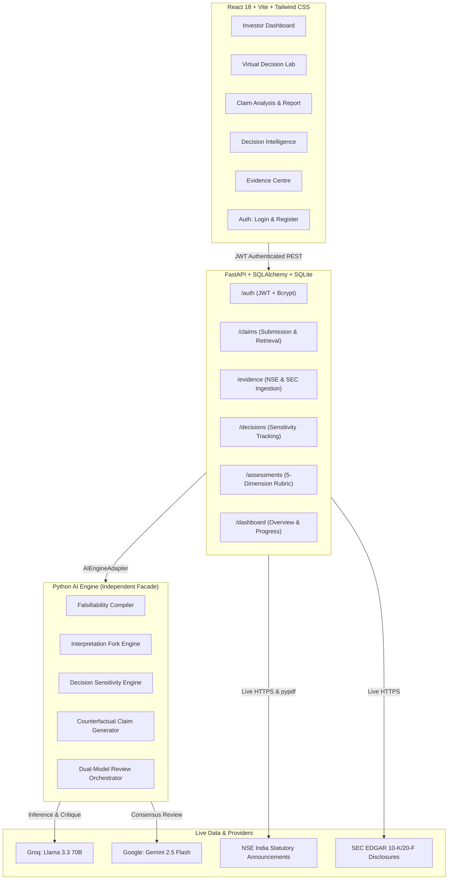

# FinTrace — Full-Stack Financial Claim Intelligence & Decision Robustness Platform

> **Autonomous Multi-Model Analysis, Regulatory Evidence Grounding & Decision Calibration Platform**  
> Developed for *The Big Hack 2.0* on branch `jos-backend`.

FinTrace protects retail and institutional investors from viral, unverified financial claims circulating on messaging channels and social media. The platform deconstructs statements into testable falsification boundaries, retrieves authentic regulatory disclosures from NSE India and SEC EDGAR, runs independent multi-model AI reviews (Groq Llama 3.3 70B & Gemini 2.5 Flash), and calibrates investor conviction through a Virtual Decision Lab and a 5-dimension deterministic evaluation rubric.

---

## 1. System Architecture



---

## 2. The Four Innovation Engines

### A. Falsifiability Compiler
- Deconstructs natural language financial claims into entity, measurable assertions, target values, time horizon, and explicit invalidation thresholds.
- Strictly preserves unstated parameters as `null`—never hallucinates unmentioned targets or dates.
- Calculates an objective falsifiability score in $[0.0, 1.0]$. Claims without quantifiable bounds or observable sources receive low scores.

### B. Interpretation Fork Engine
- Detects textual ambiguities (unanchored timeframes like `"soon"`, undefined margin types like gross vs. operating margin, or missing volume metrics).
- Synthesizes distinct, plausible scenario interpretations labeled as `AI-Generated Interpretation (Hypothesis)`.
- Defines the exact distinguishing evidence or future disclosure required to resolve each fork.

### C. Decision Sensitivity Engine
- Tracks investor confidence ($1.0$ to $5.0$) and hypothetical virtual allocation ($0.0\%$ to $100.0\%$) before and after reviewing counter-evidence.
- Provides neutral explanations of behavioral shifts. Includes a mandatory behavioral disclaimer:
  > *Allocation sensitivity is descriptive behavioral data, not an investment quality score. A smaller allocation is not inherently safer or better.*
- Flags unexplained variance when conviction changes without supporting written rationale.

### D. Counterfactual Learning Engine
- Synthesizes structurally comparable practice claims containing specific preserved flaws (`VAGUE_TIMEFRAME`, `VAGUE_METRIC`, `MISSING_INVALIDATION`, `HYPERBOLIC_CERTAINTY`).
- Employs strictly synthetic demo entities (e.g. `Apex Dynamics Ltd.`, `Novus Energy Corp.`) to prevent real-world market misinformation.
- Presents claims without revealing AI conclusions or solution hints, testing independent transfer learning.

---

## 3. Five-Dimension Learning Evaluation

Evaluates critical analytical capabilities across **Baseline**, **Assisted Practice**, and **Independent Transfer** stages:
1. **Evidence Evaluation (0–20 pts):** Distinguishing primary statutory filings from secondary social claims.
2. **Claim Specificity (0–20 pts):** Detecting omitted parameters (horizon, target, baseline comparisons).
3. **Risk Awareness (0–20 pts):** Articulating downside and market execution risks.
4. **Assumption Awareness (0–20 pts):** Recognizing that multiple interpretations exist under varying premises.
5. **Confidence Justification & Epistemic Alignment (0–20 pts):** Calibrating assertiveness against available evidence backing. (Avoids misapplying Brier scores to unobservable, non-probabilistic claims).

---

## 4. Technology Stack & Directory Structure

```
FinTrace/
├── ai-engine/               # Autonomous AI innovation engines
│   ├── assessment/          # Evaluator & scoring schemas
│   ├── claim_extraction/    # Compiler, extractor & risk indicators
│   ├── interpretation/      # Fork engine, sensitivity & counterfactual generator
│   ├── providers/           # Groq, Gemini & fallback adapters
│   └── tests/               # 110 automated unit & regression tests
├── backend/                 # FastAPI REST backend
│   ├── app/                 # Routes, models, schemas, repositories & services
│   ├── tests/               # 79 automated integration, auth & stabilization tests
│   └── fintrace.db          # SQLite persistent database
└── frontend/                # React 18 single-page application
    ├── src/
    │   ├── components/      # Layout, navigation, theme toggle
    │   ├── pages/           # Dashboard, Decision Lab, Reports, Evidence, Auth
    │   └── services/api.js  # Production API client (zero mock data)
    └── dist/                # Production build artifacts
```

---

## 5. Quickstart & Installation Instructions

### Prerequisites
- Python 3.11+
- Node.js 18+ & npm
- Valid Groq API Key & Gemini API Key (optional for offline testing; required for live model inference)

### Step 1: Backend Setup
```powershell
# Navigate to repository root
Set-Location c:\Projects\FinTrace\FinTrace

# Install backend dependencies
pip install -r backend/requirements.txt
pip install -r ai-engine/requirements.txt

# Configure environment variables
Copy-Item backend/.env.example backend/.env
Copy-Item ai-engine/.env.example ai-engine/.env

# Add GROQ_API_KEY and GEMINI_API_KEY to ai-engine/.env
```

### Step 2: Start Backend Server
```powershell
python -m uvicorn backend.app.main:app --reload --host 0.0.0.0 --port 8000
```
- Interactive Swagger UI: `http://localhost:8000/docs`
- ReDoc Documentation: `http://localhost:8000/redoc`

### Step 3: Frontend Setup & Build
```powershell
Set-Location frontend
npm install
npm run build
npm run dev
```
- Application Web UI: `http://localhost:5173`

---

## 6. Verification & Automated Test Suites

FinTrace maintains 100% test pass rates across all components:

| Test Suite | Command | Coverage & Status |
| :--- | :--- | :--- |
| **Backend Integration & Unit** | `python -m pytest backend/tests/ -q -c backend/pytest.ini` | **74 passed** (Full database, routes, regulatory retrieval) |
| **Final Phase E2E & Engines** | `python -m pytest backend/tests/test_final_development_phase.py -v -c backend/pytest.ini` | **5 passed** (Complete user lifecycle, 4 engines, 5 dimensions) |
| **Authentication & Isolation** | `python -m pytest backend/tests/test_auth.py -v -c backend/pytest.ini` | **15 passed** (Bcrypt, JWT, token expiration, user isolation) |
| **AI Engine Test Suite** | `python -m pytest ai-engine/tests/ -q` | **110 passed** (Circuit breaker, providers, telemetry, fallback) |
| **Frontend Production Build** | `Set-Location frontend; npm run build` | **46 modules transformed**, 0 errors (Vite production build) |

---

## 7. Known Limitations & Security Considerations

1. **Exchange Scraper Rate Limits:** NSE India and SEC EDGAR enforce strict rate limiting and user-agent requirements. Under extreme query volume or temporary network blocks, the system gracefully falls back to recorded disclosure archives with transparent UI status.
2. **Stateless JWT Storage:** Client-side routing persists the session token in `localStorage`. For bank-grade multi-tenant production, migration to HttpOnly secure SameSite cookies is recommended.
3. **Simulation Disclaimer:** All hypothetical portfolio allocations and sensitivity deltas in the Virtual Decision Lab are purely educational simulations and do not constitute financial advice or investment recommendations.
