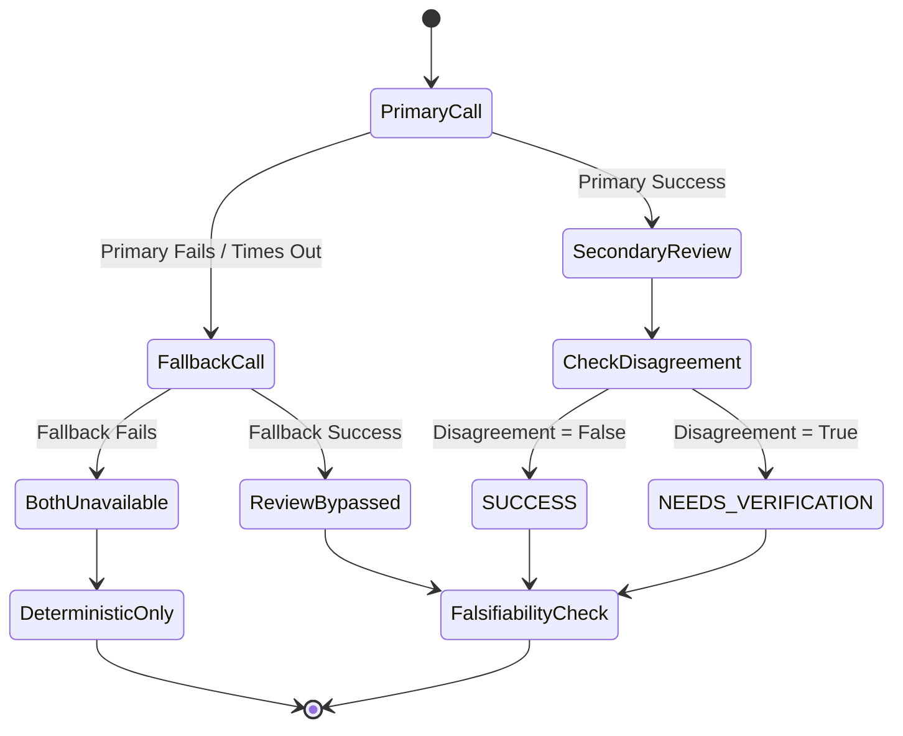

# FinTrace — AI Integration Handover Guide
**Target Teammate:** Venkat (`venkat-ai`)  
**Backend Author:** Jos (`jos-backend`)  
**Role:** AI Engine & Model Orchestration Handover

---

## 1. Overview & Separation of Concerns

FinTrace uses a modular architecture separating the backend service layer from the AI reasoning engine:
- **Backend Component (`jos-backend`):** Implements thin HTTP provider adapters, deterministic schema validators, fallback failover state machines, disagreement detection, and database persistence.
- **AI Engine Component (`venkat-ai`):** Responsible for prompt engineering, model tuning, advanced financial extraction pipelines, domain-specific falsification heuristics, and AI reasoning models.

This guide details the existing backend adapter interface, expected JSON schemas, provider status transitions, and integration points so you can easily enhance or replace model logic without altering backend routes or database logic.

---

## 2. Provider Abstraction Interface

All AI integrations implement the abstract base class `BaseAIProvider` defined in `backend/app/integrations/ai_client.py`:

```python
from abc import ABC, abstractmethod
from typing import Dict, Any, List, Optional

class BaseAIProvider(ABC):
    def __init__(self, api_key: Optional[str] = None, timeout: float = 15.0):
        self.api_key = api_key
        self.timeout = timeout
        self.name = "base"

    @abstractmethod
    async def analyze_claim(
        self,
        claim_text: str,
        evidence_bundle: List[Dict[str, Any]]
    ) -> Dict[str, Any]:
        """Perform first-pass claim extraction and interpretation."""
        pass

    @abstractmethod
    async def review_analysis(
        self,
        claim_text: str,
        evidence_bundle: List[Dict[str, Any]],
        primary_analysis: Dict[str, Any]
    ) -> Dict[str, Any]:
        """Perform secondary independent review to detect hallucination or disagreement."""
        pass
```

---

## 3. Implemented Adapters

### A. `GroqProvider`
- **Location:** `backend/app/integrations/ai_client.py`
- **Model:** `llama-3.3-70b-versatile`
- **Endpoint:** `https://api.groq.com/openai/v1/chat/completions`
- **Format:** Native JSON object mode (`response_format={"type": "json_object"}`)
- **Default Role:** Configured as `PRIMARY_AI_PROVIDER="groq"` in `.env.example`

### B. `GeminiProvider`
- **Location:** `backend/app/integrations/ai_client.py`
- **Model:** `gemini-2.5-flash`
- **Endpoint:** `https://generativelanguage.googleapis.com/v1beta/models/gemini-2.5-flash:generateContent`
- **Format:** Parses structured JSON with markdown code-fence stripping
- **Default Role:** Configured as `SECONDARY_AI_PROVIDER="gemini"` in `.env.example`

---

## 4. Expected Payloads & Schemas

### 4.1 Input to `analyze_claim`
- **`claim_text` (str):** The user's unmodified financial claim text.
- **`evidence_bundle` (list of dicts):** Verified disclosures retrieved for this claim:
```json
[
  {
    "title": "NSE Announcement: Audited Q2 Financial Results",
    "publisher": "NSE India",
    "source_url": "https://nsearchives.nseindia.in/corporate/INFY_Results.pdf",
    "content_summary": "Q2 constant-currency revenue up 5.1% YoY, operating margin 21.1%.",
    "provenance_status": "REAL"
  }
]
```

### 4.2 Required Output from `analyze_claim`
The AI engine must return a JSON dictionary matching this structure:
```json
{
  "direction": "BULLISH",
  "target": 20.0,
  "horizon": "3 weeks",
  "missing_fields": ["entry_condition", "exit_condition", "invalidation_condition"],
  "interpretation_summary": "The claim forecasts a 20% upside based on Q2 revenue figures, but lacks explicit invalidation criteria."
}
```
*Rule:* Missing or unstated fields must be returned as explicit `null` or listed in `missing_fields`. The backend strictly forbids fabricating target values or timeframes.

### 4.3 Input to `review_analysis`
- `claim_text` (str)
- `evidence_bundle` (list of dicts)
- `primary_analysis` (dict): The exact output produced by the primary provider above.

### 4.4 Required Output from `review_analysis`
```json
{
  "agrees": true,
  "material_disagreements": [],
  "critique": "The primary analysis accurately reflects the absence of invalidation bounds."
}
```
If the reviewer detects contradictions (e.g. primary claims 50% growth when filing says -5%), set:
```json
{
  "agrees": false,
  "material_disagreements": ["Earnings growth contradicted by audited Q2 net loss"],
  "critique": "Primary provider failed to note negative operating cash flow."
}
```

---

## 5. Orchestration, Fallback & Status Lifecycle

The backend `AnalysisOrchestrator` (`backend/app/services/analysis_orchestrator.py`) handles the execution lifecycle:



### Status Reference:
- `SUCCESS`: Primary provider succeeded and secondary reviewer concurred.
- `FALLBACK_USED`: Primary provider was unavailable or timed out; secondary provider answered.
- `NEEDS_VERIFICATION`: Primary and secondary outputs had material disagreements; human verification recommended.
- `PROVIDER_UNAVAILABLE`: Neither provider had working credentials or network access. FinTrace falls back to deterministic rule-based evaluation without crashing.

---

## 6. How to Integrate Your Custom AI Engine

If you develop a dedicated AI engine in the `venkat-ai` component:
1. Implement a new class inheriting from `BaseAIProvider`:
   ```python
   # backend/app/integrations/ai_client.py
   class VenkatAIEngineProvider(BaseAIProvider):
       def __init__(self, ...):
           self.name = "venkat-ai-engine"
       ...
   ```
2. Register it in `get_ai_provider(provider_name)` factory in `ai_client.py`.
3. Set `PRIMARY_AI_PROVIDER="venkat-ai-engine"` in `backend/.env`.
4. No database models or API routes need to be modified.
