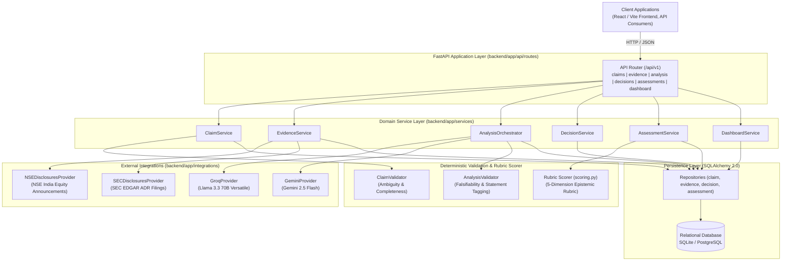
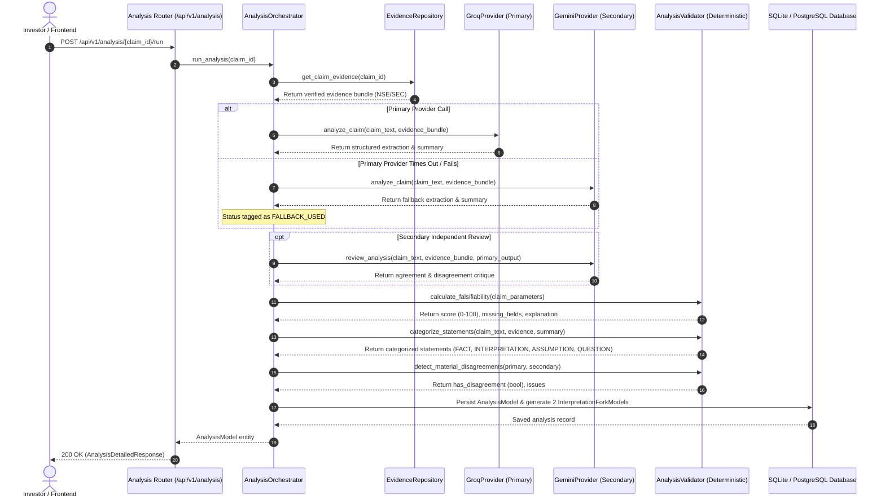

# FinTrace — Backend Architecture Document

## 1. System Overview

**FinTrace** is an investor decision intelligence and decision robustness platform developed by Team AetherCoders for *The Big Hack 2.0*. Its primary objective is to transform speculative retail investment instincts into disciplined, evidence-based critical evaluation through automated claim deconstruction, epistemological statement classification, multi-exchange regulatory evidence retrieval, and virtual counterfactual decision-making.

The backend acts as the foundational engine of FinTrace, providing:
1. **Deterministic Claim Parsing & Invalidation Checks:** Extracts structural attributes while preserving unstated parameters strictly as `null`.
2. **Decision Robustness Compiler:** Coordinates multi-provider LLM analysis (Groq & Gemini) with automatic fallback, independent secondary review, and material disagreement detection.
3. **Multi-Exchange Evidence Retrieval:** Direct statutory corporate announcement and PDF circular retrieval via NSE India as the primary source, alongside US SEC EDGAR filings for verified dual-listed ADRs.
4. **Virtual Decision Lab:** Counterfactual stance tracking and sensitivity calculation before and after exposure to counter-evidence.
5. **Investor Assessment & Epistemic Alignment Engine:** A 5-dimension deterministic scoring rubric tracking investor learning between Baseline, Assisted Practice, and Independent Transfer stages.

---

## 2. Directory Structure

The backend follows an audited modular architecture separating presentation, business logic, persistence, and external adapters:

```
backend/
├── app/
│   ├── main.py                     # FastAPI application factory, middleware, route mounting
│   ├── core/
│   │   ├── config.py               # Pydantic BaseSettings (environment variables)
│   │   └── database.py             # SQLAlchemy engine, session maker, SQLite dynamic column migrator
│   ├── models/                     # SQLAlchemy declarative ORM models
│   │   ├── base.py                 # BaseModelMixin (UUID primary keys, UTC timestamps)
│   │   ├── claim.py                # ClaimModel & InterpretationForkModel
│   │   ├── evidence.py             # EvidenceModel & ClaimEvidenceModel
│   │   ├── analysis.py             # AnalysisModel
│   │   ├── decision.py             # DecisionModel
│   │   └── assessment.py           # AssessmentModel
│   ├── schemas/                    # Pydantic v2 validation models
│   │   ├── common.py               # ProvenanceStatus, ClaimDirection, ProviderStatus, AssessmentStage enums
│   │   ├── claim.py                # ClaimCreate, ClaimResponse, ClaimListResponse
│   │   ├── evidence.py             # EvidenceCreate, EvidenceResponse, ClaimEvidenceListResponse
│   │   ├── analysis.py             # AnalysisDetailedResponse, CategorizedStatements, InterpretationForkResponse
│   │   ├── decision.py             # DecisionCreate, DecisionRevise, DecisionResponse, DecisionSensitivitySummary
│   │   ├── assessment.py           # AssessmentCreate, AssessmentResponse, AssessmentComparisonResponse
│   │   └── dashboard.py            # DashboardOverviewResponse, DashboardProgressResponse, DashboardHistoryResponse
│   ├── repositories/               # Pure data-access layer (CRUD operations)
│   │   ├── claim_repository.py
│   │   ├── evidence_repository.py
│   │   ├── decision_repository.py
│   │   └── assessment_repository.py
│   ├── services/                   # Business domain orchestration
│   │   ├── claim_service.py        # Claim submission, validation, query
│   │   ├── evidence_service.py     # Disclosure retrieval, deduplication, URL normalization
│   │   ├── analysis_orchestrator.py# Multi-LLM compiler, fallback, fork generation
│   │   ├── decision_service.py     # Stance revision, sensitivity computation
│   │   ├── assessment_service.py   # Rubric evaluation, progress comparison
│   │   └── dashboard_service.py    # Metric aggregation
│   ├── validators/                 # Rule-based deterministic evaluators
│   │   ├── claim_validator.py      # Entity ambiguity and parameter completeness
│   │   └── analysis_validator.py   # Falsifiability scoring, statement tagging, disagreement detection
│   ├── integrations/               # External service adapters
│   │   ├── ai_client.py            # BaseAIProvider, GroqProvider, GeminiProvider
│   │   └── evidence_provider.py    # NSEDisclosuresProvider, SECDisclosuresProvider, CorporateDisclosuresProvider
│   ├── utils/                      # Rubric calculators
│   │   └── scoring.py              # 5-dimension deterministic rubric & epistemic alignment scoring
│   └── api/
│       └── routes/                 # Thin HTTP controller endpoints
│           ├── health.py           # /api/v1/health
│           ├── claims.py           # /api/v1/claims
│           ├── evidence.py         # /api/v1/evidence
│           ├── analysis.py         # /api/v1/analysis
│           ├── decisions.py        # /api/v1/decisions
│           ├── assessments.py      # /api/v1/assessments
│           └── dashboard.py        # /api/v1/dashboard
├── docs/                           # Technical documentation & handover guides
├── tests/                          # 39 passing Pytest automated test scenarios
├── API_CONTRACT.md                 # Frontend/AI contract specification
├── pytest.ini                      # Pytest runner configuration
├── requirements.txt                # Production and test dependencies
└── .env.example                    # Environment variable template
```

---

## 3. High-Level Architecture Diagram



---

## 4. Module Responsibilities & Request Lifecycle

### A. Claims Module
- **Entry:** `POST /api/v1/claims`
- **Validation:** `ClaimValidator` performs rule-based scanning for entity ambiguity (detecting ambiguous words like "Reliance" without specific entity identifiers or conflicting tickers).
- **Persistence:** Preserves omitted claim criteria (such as missing target prices, missing invalidation conditions, or missing time horizons) strictly as `None`/`null`. Never hallucinates or default-fills unstated values.

### B. Evidence Retrieval Module
- **Entry:** `POST /api/v1/evidence/{claim_id}/retrieve`
- **Resolution:** Resolves issuer symbols against verified registries (`VERIFIED_NSE_REGISTRY`).
- **Isolation:**
  - Queries `NSEDisclosuresProvider` for authentic corporate announcements and direct PDF circulars from `nsearchives.nseindia.in`.
  - Queries `SECDisclosuresProvider` strictly for issuers with confirmed US ADR registrations (e.g., Infosys Ltd CIK `0001067491`). Barred for domestic-only issuers like TCS or Reliance Industries.
- **Deduplication:** Normalizes source URLs and filters exact duplicates.
- **Provenance:** Assigns `source_jurisdiction` (`IN`, `US`), `exchange` (`NSE`, `SEC`), and `provenance_status` (`REAL`).

### C. Decision Robustness Compiler Module
- **Entry:** `POST /api/v1/analysis/{claim_id}/run`
- **Multi-Provider Flow:**
  1. Gathers evidence associated with the claim.
  2. Submits claim and evidence bundle to the primary provider (Groq Llama 3.3 70B).
  3. If primary provider fails or times out, activates fallback to the secondary provider (Gemini 2.5 Flash), tagging `provider_status="FALLBACK_USED"`.
  4. If both providers fail, records `provider_status="PROVIDER_UNAVAILABLE"` without generating synthetic statements.
  5. If primary succeeds, requests an independent cross-review from the secondary provider.
  6. Evaluates material disagreement between providers (`NEEDS_VERIFICATION`).
  7. Computes deterministic falsifiability score (0–100) based on presence of specific testability conditions.
  8. Categorizes statements into `SOURCE_FACT`, `AI_INTERPRETATION`, `USER_ASSUMPTION`, and `UNRESOLVED_QUESTION`.
  9. Generates two opposing counterfactual `InterpretationFork` records.

### D. Virtual Decision Lab Module
- **Entry:** `POST /api/v1/decisions` & `PUT /api/v1/decisions/{decision_id}/revise`
- **Purpose:** Purely educational, counterfactual stance tracking without real-money execution.
- **Sensitivity:** Calculates percentage point conviction drift (`confidence_delta_points`, `allocation_delta_points`) and behavioral classification (`REDUCED_EXPOSURE`, `INCREASED_EXPOSURE`, `UNCHANGED`, `CONVICTION_SHIFT`).

### E. Assessment & Scoring Module
- **Entry:** `POST /api/v1/assessments` & `GET /api/v1/assessments/compare/{session_id}`
- **Rubric Dimensions (20 pts each, total 100 pts):**
  1. *Evidence Evaluation:* Ability to distinguish primary regulatory disclosures from secondary claims.
  2. *Claim Specificity:* Ability to identify unstated parameters and missing falsification boundaries.
  3. *Risk Awareness:* Identification of downside and market headwinds.
  4. *Assumption Awareness:* Critical recognition of alternative plausible interpretations.
  5. *Confidence Justification & Epistemic Alignment:* 4-component rubric evaluating evidence backing, uncertainty awareness, risk reflection, and substantive reasoning.
- **Stage Comparison:** Measures skill acquisition from `BASELINE` to `INDEPENDENT_TRANSFER`.

---

## 5. Sequence Diagram: Claim Analysis Workflow


