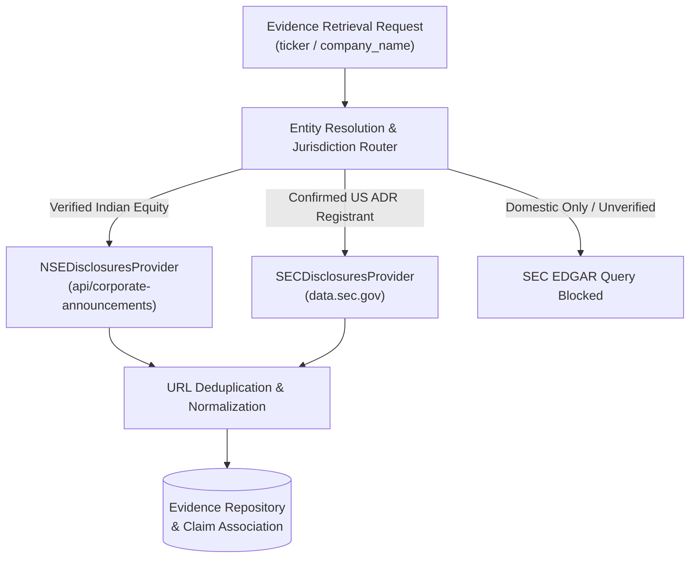

# FinTrace — Financial Evidence Retrieval & Provenance Architecture

This document details the multi-exchange financial evidence retrieval system, entity resolution registries, anti-hallucination guards, and exchange limitations implemented in FinTrace.

---

## 1. Executive Summary & Design Principles

In speculative social media financial discourse, retail investors are routinely misled by out-of-context claims citing "strong fundamentals," "record growth," or "impending breakouts" without primary evidence.

FinTrace enforces rigorous **Epistemic Data Provenance**:
1. **Primary Exchange Precedence:** Disclosures must originate from statutory filing bodies (NSE India, SEC EDGAR).
2. **Zero Hallucination Guarantee:** If an entity is unlisted, fictitious, or has no filings matching the query, the retrieval engine returns an empty list (`[]`). FinTrace strictly forbids generating synthetic citations or web snippets.
3. **Strict Entity Isolation:** Prevents cross-jurisdiction entity collisions (e.g., confusing Indian blue-chips with unrelated US companies sharing a word in their name).
4. **Verifiable Audit Trail:** Every evidence record persists the original document title, publisher, direct PDF/source URL, publication timestamp, retrieval timestamp, and origin jurisdiction.

---

## 2. Multi-Exchange Provider Architecture

---

## 3. NSE India Integration (Primary Indian Source)

- **Provider Class:** `NSEDisclosuresProvider` (`backend/app/integrations/evidence_provider.py`)
- **Primary Endpoint:** `https://www.nseindia.com/api/corporate-announcements?index=equities&symbol={symbol}`
- **PDF Archive Base:** `https://nsearchives.nseindia.in/corporate/...`
- **Request Headers:**
  - `User-Agent`: Desktop browser user-agent header.
  - `Accept`: `application/json, text/plain, */*`
  - `Accept-Language`: `en-US,en;q=0.9`
  - `follow_redirects`: `True`

### Data Extraction & Field Mapping

| NSE JSON Field | Extracted Property | Description |
|---|---|---|
| `sm_name` | `company_name` | Registered company name (e.g., "Infosys Limited") |
| `symbol` | `company_symbol` | NSE Trading Symbol (e.g., `INFY`) |
| `sm_isin` | `company_isin` | ISIN code (e.g., `INE009A01021`) |
| `desc` | `title` | Announcement subject header |
| `attchmntText` | `document_title` / `content_summary` | Full announcement text reported to the exchange |
| `an_dt` | `publication_date` | Date-time of filing (e.g., `"18-Nov-2026 22:10:55"`) parsed into UTC `datetime` |
| `attchmntFile` | `source_url` | Direct URL to original company announcement PDF |
| *(System)* | `publisher` | Stamped as `"NSE India"` |
| *(System)* | `source_jurisdiction` | Stamped as `"IN"` |
| *(System)* | `exchange` | Stamped as `"NSE"` |
| *(System)* | `provenance_status` | Stamped as `"REAL"` |

---

## 4. SEC EDGAR Integration (Supplementary US Source)

- **Provider Class:** `SECDisclosuresProvider` (`backend/app/integrations/evidence_provider.py`)
- **Primary Endpoint:** `https://data.sec.gov/submissions/CIK{cik.zfill(10)}.json`
- **Browse URL:** `https://www.sec.gov/edgar/browse/?CIK={cik}`
- **Compliance Header:** `User-Agent: FinTraceResearchBot/1.0 (contact@fintrace.ai)`
- **Policy Guard:** SEC EDGAR is **strictly queried only** for issuers with an explicitly verified Central Index Key (CIK) representing a US domestic issuer or an active American Depositary Receipt (ADR) program.

---

## 5. Strict Entity Resolution & Anti-Collision Guards

A major failure mode in automated financial search engines is naive fuzzy matching. FinTrace implements strict guards against known entity confusion scenarios:

### 5.1 Case Study: Reliance Industries Ltd vs. Reliance, Inc. (Scottsdale, AZ)
- **The Problem:** A naive search on SEC EDGAR for "Reliance" yields `RELIANCE, INC.` (CIK `0000861884`), a US metal solutions provider based in Scottsdale, Arizona. A naive investor tool would mistakenly present US steel filings for an Indian telecom/petrochemical conglomerate.
- **The FinTrace Guard:** `RELIANCE` is registered in `VERIFIED_NSE_REGISTRY` with `has_us_adr=False`. When `SECDisclosuresProvider` receives a retrieval request for Reliance Industries, it immediately aborts the SEC query and returns `[]`.
- **Verified Result:** Reliance Industries receives 100% authentic Indian filings from NSE India and 0 false SEC records.

### 5.2 Case Study: Tata Consultancy Services (TCS)
- **The Problem:** TCS is a purely domestic Indian listed entity with no US ADR program.
- **The FinTrace Guard:** TCS is registered with `has_us_adr=False`. All SEC queries are barred.
- **Verified Result:** Only authentic filings from NSE India (`INE467B01029`) are retrieved.

### 5.3 Case Study: Dual-Listed Issuers (Infosys Limited)
- **The Situation:** Infosys trades on NSE India (`INFY`, ISIN `INE009A01021`) and on the NYSE via an ADR (`INFY`, CIK `0001067491`).
- **The FinTrace Guard:** The orchestrator retrieves disclosures from NSE India (tagged `exchange="NSE"`, `source_jurisdiction="IN"`) and statutory Form 6-K filings from SEC EDGAR (tagged `exchange="SEC"`, `source_jurisdiction="US"`). Both registries remain distinct and unmerged.

---

## 6. Pre-Configured Verified Entity Registry

The backend maintains an initial high-fidelity registry for core equities:

| Symbol | Company Name | ISIN | Exchange | US ADR / CIK |
|---|---|---|---|---|
| **INFY** | Infosys Limited | `INE009A01021` | NSE | Yes (CIK `0001067491`) |
| **TCS** | Tata Consultancy Services Ltd | `INE467B01029` | NSE | No |
| **RELIANCE** | Reliance Industries Limited | `INE002A01018` | NSE | No |
| **HDFCBANK** | HDFC Bank Limited | `INE040A01034` | NSE | Yes (CIK `0001144967`) |
| **WIPRO** | Wipro Limited | `INE075A01022` | NSE | Yes (CIK `0001123799`) |

---

## 7. BSE India Access Limitation Notice

- **Observed Behavior:** Automated requests to BSE endpoints (`api.bseindia.com` or `bseindia.com`) return `HTTP 403 Forbidden` (`<TITLE>Access Denied</TITLE>`) enforced by Akamai Web Application Firewall (WAF).
- **Compliance Policy:** FinTrace strictly adheres to standard security and access guidelines and **does not attempt to bypass, spoof, or circumvent Akamai WAF controls**.
- **Current Status:** Direct automated retrieval from BSE is **unsupported** in the current open release. NSE serves as the robust, verified primary disclosures source for Indian equities. Direct BSE integration will be enabled when authorized market data enterprise feeds are provisioned.

---

## 8. Verification Strategy: Unit Tests vs. Live Tests

1. **Unit & Edge-Case Tests (`tests/test_indian_evidence.py`):**
   - Mocked using `unittest.mock.patch` for deterministic execution.
   - Tests HTTP 403 Forbidden handling.
   - Tests HTTP 429 Rate Limiting handling.
   - Tests network timeout handling.
   - Tests malformed JSON payload recovery.
   - Tests URL deduplication and missing publication date handling.
2. **Live Integration Tests:**
   - `test_live_nse_announcements_retrieval`: Executes live network calls to NSE India for `INFY`, `TCS`, and `RELIANCE`, confirming live response structures, valid PDF URLs, and authentic announcement metadata.
