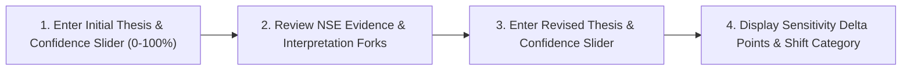

# FinTrace — Frontend Integration Handover Guide
**Target Teammate:** Nakul (`nakul-frontend`)  
**Backend Author:** Jos (`jos-backend`)  
**Role:** Frontend & UI Integration Handover

---

## 1. Quick Start & Connection Details

- **Backend Base URL:** `http://localhost:8000/api/v1`
- **Swagger Documentation:** `http://localhost:8000/docs`
- **CORS Configuration:** Configured to accept `http://localhost:3000` and `http://localhost:5173` (Vite / Next.js / Create-React-App).
- **Authentication:** **None**. You do **not** need Bearer tokens or JWTs. FinTrace tracks user learning sessions using a plain string identifier: `session_id` (e.g., `"user_123"` or a client-generated UUID saved in `localStorage`).
- **Data Format:** All request and response bodies use standard JSON with `snake_case` keys.

---

## 2. Core UI Flows & Integration Guide

### 2.1 Flow 1: Claim Submission & Ambiguity Handling

#### Step A: Submit Claim
Call `POST /api/v1/claims` when the user enters or pastes a financial claim:

```typescript
// Example Request
const response = await fetch("http://localhost:8000/api/v1/claims", {
  method: "POST",
  headers: { "Content-Type": "application/json" },
  body: JSON.stringify({
    original_claim: "Infosys will rally 20% in the next month following Q3 results.",
    ticker: "INFY",
    company_name: "Infosys Limited",
    exchange: "NSE",
    source_platform: "Twitter/X"
  })
});
const claim = await response.json();
```

#### Step B: Handle Entity Ambiguity Banner
If the user inputs an ambiguous company (e.g. "Reliance" without specifying if they mean Reliance Industries or another firm):
- Inspect `claim.is_ambiguous_entity`.
- If `true`, render an alert banner displaying `claim.entity_ambiguity_notes`.

---

### 2.2 Flow 2: Exchange Evidence & Provenance Display

#### Step A: Trigger Evidence Retrieval
Call `POST /api/v1/evidence/{claim.id}/retrieve` to fetch genuine regulatory disclosures:

```typescript
const evResponse = await fetch(`http://localhost:8000/api/v1/evidence/${claim.id}/retrieve`, {
  method: "POST"
});
const evidenceData = await evResponse.json();
// evidenceData.items contains array of { relevance_score, evidence: EvidenceResponse }
```

#### Step B: Display Evidence Cards & Provenance Badges
Render each item in `evidenceData.items` with distinct provenance indicators:
- **`provenance_status` Badge:**
  - `REAL`: Green badge ("Verified Primary Disclosure")
  - `USER_PROVIDED`: Blue badge ("User Submitted")
  - `AI_GENERATED`: Purple badge ("Synthetic Interpretation")
- **`exchange` & `source_jurisdiction` Badges:**
  - `NSE` / `IN`: Indian flag or "NSE India Filing"
  - `SEC` / `US`: US flag or "US SEC EDGAR 6-K"
- **Filing Link:** Render `evidence.source_url` as an external link:
  - If NSE: points to official PDF on `https://nsearchives.nseindia.in/corporate/...`
  - If SEC: points to official filing on `https://www.sec.gov/edgar/...`

---

### 2.3 Flow 3: Decision Robustness Compiler

#### Step A: Run Compiler
Call `POST /api/v1/analysis/{claim.id}/run`:

```typescript
const analysisRes = await fetch(`http://localhost:8000/api/v1/analysis/${claim.id}/run`, {
  method: "POST"
});
const result = await analysisRes.json();
```

#### Step B: Handling Provider Statuses
Inspect `result.analysis.provider_status`:
- `SUCCESS`: Display green check ("Verified by Multi-LLM Review").
- `FALLBACK_USED`: Display blue alert ("Primary Provider Failed; Secondary Fallback Active").
- `NEEDS_VERIFICATION`: Display amber warning ("Material Disagreement Between Providers - Human Review Required"). Check `result.analysis.validation_notes`.
- `PROVIDER_UNAVAILABLE`: Display grey note ("External AI Unavailable - Deterministic Rule Evaluation Only").

#### Step C: Display Falsifiability & Categorized Statements
- **Falsifiability Gauge:** Render `result.analysis.falsifiability_score` (0–100%).
- **Statement Classification Grid:** Render the 4 columns from `result.categorized_statements_parsed`:
  1. `SOURCE_FACT`: Verified facts from text & filings.
  2. `AI_INTERPRETATION`: Inferences made by models.
  3. `USER_ASSUMPTION`: Unverified implicit premises.
  4. `UNRESOLVED_QUESTION`: Crucial missing testability conditions.

---

### 2.4 Flow 4: Virtual Decision Lab

The Decision Lab helps users realize cognitive blind spots by recording stances before and after reviewing counter-evidence.



#### Step A: Create Initial Decision
`POST /api/v1/decisions`
```json
{
  "claim_id": "<claim_id>",
  "initial_thesis": "High conviction based on viral momentum.",
  "initial_confidence": 85.0,
  "initial_allocation": 20.0
}
```

#### Step B: Revise Stance Post-Evidence
`PUT /api/v1/decisions/{decision_id}/revise`
```json
{
  "revised_thesis": "Reduced allocation due to unaddressed margin pressure in NSE disclosure.",
  "revised_confidence": 45.0,
  "revised_allocation": 5.0,
  "reason_for_change": "Discovered that revenue growth was offset by operating margin contraction."
}
```

#### Step C: Display Sensitivity Summary
The response returns `sensitivity_summary`:
- `confidence_delta_points`: e.g., `-40.0`
- `allocation_delta_points`: e.g., `-15.0`
- `reasoning_shift_type`: e.g., `"REDUCED_EXPOSURE"`
- `shift_explanation`: Human-readable summary for the investor.

---

### 2.5 Flow 5: Investor Assessments & Epistemic Alignment Scoring

FinTrace grades user critical evaluation skills across 3 progressive stages:
1. `BASELINE`: First evaluation before seeing platform hints.
2. `ASSISTED_PRACTICE`: Practice scenario with counter-prompts.
3. `INDEPENDENT_TRANSFER`: New scenario evaluating whether skill transferred.

#### Step A: Submit Assessment
`POST /api/v1/assessments`
```json
{
  "session_id": "user_session_abc",
  "claim_id": "<claim_id>",
  "assessment_stage": "BASELINE",
  "identified_evidence_types": ["COMPANY_DISCLOSURE"],
  "distinguished_primary_sources": true,
  "identified_missing_specificity": ["entry_condition", "invalidation_condition"],
  "identified_risk_factors": ["Macro tech spending slowdown"],
  "recognized_alternative_interpretations": true,
  "stated_confidence": 40.0,
  "evidence_backing_level": "LOW",
  "confidence_justification": "Maintained low 40% confidence because the claim lacks invalidation bounds despite audited revenue."
}
```

#### Step B: Display 5-Dimension Radar / Bar Chart
Render scores from `response.dimension_scores` (each 0–20, total 0–100):
1. `evidence_evaluation`: 0–20
2. `claim_specificity`: 0–20
3. `risk_awareness`: 0–20
4. `assumption_awareness`: 0–20
5. `confidence_calibration`: 0–20 (Label in UI: **"Confidence Justification & Epistemic Alignment"**)

#### Step C: Compare Baseline vs Independent Transfer
Call `GET /api/v1/assessments/compare/{session_id}`:
- Displays percentage point improvement (`percentage_point_delta`).
- Displays dimension-by-dimension skill growth (`dimension_deltas`).

---

### 2.6 Flow 6: Dashboard & Learning Progress

1. **Platform Overview:** `GET /api/v1/dashboard/overview`
   - Returns counts of claims, analyses, disclosures, and recent decisions.
2. **User Learning Progress:** `GET /api/v1/dashboard/progress?session_id={session_id}`
   - Returns stage completion status (`NOT_STARTED`, `BASELINE_COMPLETED`, `ASSESSMENT_COMPLETED`) and delta score.
3. **Evaluation History:** `GET /api/v1/dashboard/history?session_id={session_id}`
   - Returns full evaluation history timeline for progress graphs.

---

## 3. UI State Handling Guidelines

| State | Recommended UI Behavior |
|---|---|
| **Loading** | Display spinner with step label (e.g. "Retrieving official filings from NSE India...", "Running multi-LLM cross-review...") |
| **Empty Evidence** | Display empty state card: "No statutory disclosures matched this entity. FinTrace does not fabricate unverified citations." |
| **Ambiguous Entity** | Render prominent warning banner asking user to confirm exchange ticker or specific legal entity. |
| **Error / Timeout** | Display retry button. The backend is designed with timeouts so requests will fail cleanly within 15 seconds rather than hang indefinitely. |
