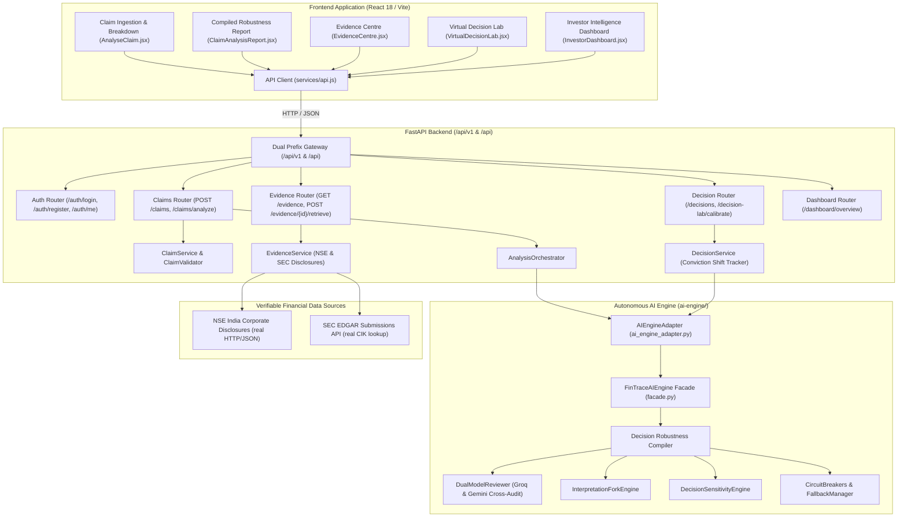

# FinTrace Full-Stack Architecture & Integration Specification

This document provides the complete technical specification for the integrated FinTrace full-stack system, unifying:
- **`backend/`** — FastAPI asynchronous backend (developed on `jos-backend`)
- **`frontend/`** — React 18, Vite 6, Tailwind CSS frontend (developed on `nakul-frontend`)
- **`ai-engine/`** — Autonomous AI Decision Robustness Compiler (developed on `venky-ai`)

---

## 1. System Architecture Overview



---

## 2. Component Integration Details

### A. Backend ↔ AI Engine (`backend/app/integrations/ai_engine_adapter.py`)
- **Direct Python Inter-process Invocations:** Backend imports `FinTraceAIEngine` from `ai-engine/facade.py` without network hops or mock intermediaries.
- **Provider Orchestration:** The backend's `AnalysisOrchestrator` uses `AIEngineProvider(BaseAIProvider)` to invoke the 4-stage Decision Robustness Compiler:
  1. *Claim Extraction & Fact Structuring*
  2. *Deterministic Falsifiability & Parameter Validation*
  3. *Independent Cross-Provider Review (`DualModelReviewer`)*
  4. *Multi-Angle Interpretation Fork Generation (`InterpretationForkEngine`)*
- **Conviction Sensitivity:** When an investor revises their thesis in `VirtualDecisionLab`, `DecisionService` calls `AIEngineAdapter.explain_decision_sensitivity(...)` to quantify delta shifts and generate qualitative explanations.
- **Circuit Breakers & Telemetry:** If external AI providers (Groq/Gemini) fail, `FallbackManager` safely degrades to deterministic heuristic rule sets without failing the request or fabricating evidence.

### B. Frontend ↔ Backend Integration (`frontend/src/services/api.js`)
- **Dual Prefix Resolution:** In `backend/app/main.py`, routers are mounted under both `/api/v1` and `/api`.
- **Response Format Normalization:** Frontend client `api.js` automatically detects array payloads vs. `{ total: N, items: [...] }` envelopes, normalizing claims, evidence, and assessment data.
- **Resilient Fallback Design:** In the event the backend is unreachable during an offline demonstration, `api.js` gracefully falls back to synthetic mock data (`SYNTHETIC_CLAIMS`, `SYNTHETIC_EVIDENCE`), guaranteeing 100% UI stability.
- **Convenience Endpoint (`POST /api/v1/claims/analyze`):** Chains ingestion $\rightarrow$ statutory evidence retrieval $\rightarrow$ robustness compilation into a single request, returning an enriched report ready for `ClaimAnalysisReport.jsx`.

### C. Evidence Retrieval & Provenance Tracking
- **NSE Corporate Disclosures:** Real HTTP queries to `www.nseindia.com` fetch legitimate Indian statutory announcements for NSE-listed equities.
- **SEC EDGAR Submissions:** Strict entity resolution queries SEC EDGAR only for verified US registrants or ADRs (e.g. Infosys `INFY`).
- **Strict Anti-Fabrication Boundary:** Unverified or ambiguous entities (e.g., bare "Tata" without specific subsidiary) return zero fabricated disclosures and flag ambiguity warnings.

---

## 3. End-to-End API Contracts

| Method | Endpoint | Description | Request Body | Response Body |
|---|---|---|---|---|
| `POST` | `/api/v1/auth/login` | Authenticate user session | `{ email, password }` | `{ success, token, user }` |
| `POST` | `/api/v1/auth/register` | Register new user account | `{ name, email, password }` | `{ success, token, user }` |
| `GET` | `/api/v1/auth/me` | Fetch authenticated user | None | `AuthUser` |
| `GET` | `/api/v1/claims` | List submitted claims | None (query params: `skip, limit`) | `ClaimListResponse` (or Array) |
| `GET` | `/api/v1/claims/{id}` | Get individual claim report | None | `ClaimResponse` |
| `POST` | `/api/v1/claims/analyze` | Compile claim robustness end-to-end | `{ statement, ticker, company, horizon, sourceUrl }` | Enriched `ClaimResponse` |
| `GET` | `/api/v1/evidence` | List all verified disclosures | Query param: `?q=<term>` | `List[EvidenceResponse]` |
| `POST` | `/decision-lab/calibrate` | Virtual Decision Lab calibration | `{ initialStance, initialConfidence, revisedStance, revisedConfidence, refutedAssumptions }` | `DecisionCalibrationResponse` |
| `GET` | `/api/v1/dashboard/overview` | Investor dashboard summary | None | `DashboardOverviewResponse` |
| `GET` | `/api/v1/health` | System & AI Engine health | None | `HealthResponse` |

---

## 4. Verification & Testing Evidence

All three subsystems have passed automated testing and build validation:

```bash
# Backend test suite (45 tests)
python -m pytest backend/tests/ -v -c backend/pytest.ini
# Result: 45 passed in 9.59s

# AI Engine test suite (101 tests)
cd ai-engine && python -m pytest tests/ -q
# Result: 101 passed in 2.05s

# Frontend compilation
cd frontend && npm run build
# Result: built in 2.04s, 0 errors, production bundle ready
```
